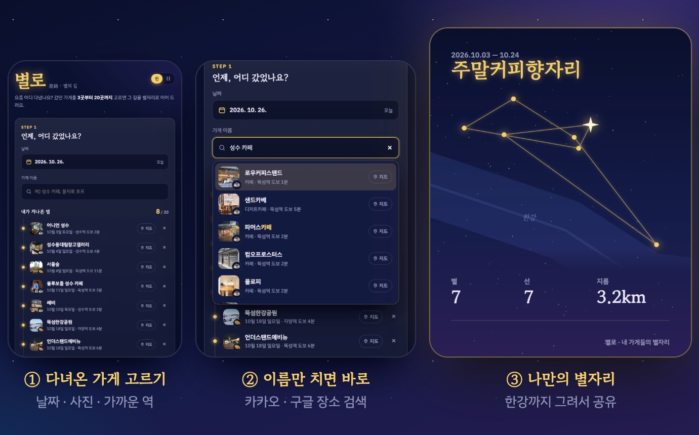

<div align="center">


<br>

# 별로 星路

**다녀온 가게들이 밤하늘의 별이 돼요.**

갔던 가게를 고르면, 그 길을 이어 나만의 별자리를 그려 드려요.<br>
친구에게 보내면 "너 요즘 어디 다녀?"가 한 장으로 끝나요.

<br>

[**✦ 지금 별자리 만들기 →**](https://everythingsoso.com)

</div>

<br>



<br>

## ✦ 별자리 읽는 법

<table>
<tr>
<td width="50%">

**⭐ 별 하나 = 가게 하나**<br>
<sub>자주 간 단골 가게일수록 크고 밝게, 두 번 넘게 가면 반짝여요</sub>

**〰️ 선 = 다녀온 순서**<br>
<sub>날짜 순서대로 이어서, 내가 걸은 길이 그대로 모양이 돼요</sub>

</td>
<td width="50%">

**🌊 한강**<br>
<sub>근처에 한강이 있으면 같이 그려서 어느 동네인지 보여요</sub>

**🔒 가게 이름은 비밀**<br>
<sub>공유 이미지엔 별과 선, 별자리 이름만 남아요</sub>

</td>
</tr>
</table>

별자리 이름은 다닌 곳에 따라 자동으로 붙어요.<br>
같은 데만 가면 `고인물자리`, 서울 끝에서 끝까지 다니면 `역마살자리`, 카페만 돌면 `얼죽아자리`.

<br>


<br>

<div align="center">

<sub>

**별로**는 "별의 길(星路)"이라는 뜻이에요. 그리고… 이번 달, 별로였어?

<br>

Vanilla JS · Kakao Local · Google Places · OpenStreetMap · GitHub Pages

</sub>

</div>

<details>
<summary><sub>개발 메모</sub></summary>

```bash
cp .env.example .env        # KAKAO_JS_KEY, GOOGLE_MAPS_KEY
node build-config.mjs       # .env → config.js
python3 -m http.server 8790 # http://localhost:8790
node logic.test.mjs         # 별자리 계산 테스트
```

- 배포: `main`에 push하면 GitHub Actions가 저장소 Secret의 키로 `config.js`를 만들어 배포해요.
- 검색: 카카오 → (결과가 적거나 실패하면) 구글 → OpenStreetMap. 일본어 검색어는 구글부터.
- 키는 각 콘솔에서 `everythingsoso.com` 도메인으로 제한해 두었어요.
- 지도·역·한강 데이터 © OpenStreetMap contributors (ODbL).

</details>
