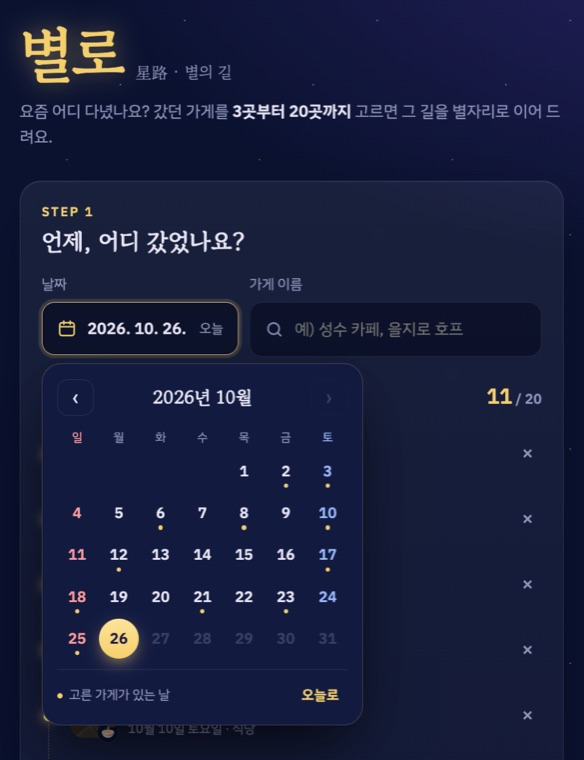
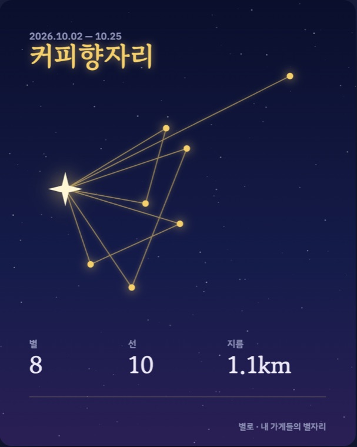

<div align="center">


# 별로 星路

**내가 다녀온 가게들을 이어 만드는 나만의 별자리**

`별로`는 "별의 길(星路)"이라는 뜻이에요. 이번 달 별로였어?


**[▶ 바로 써보기](https://chromeheartz.github.io/byeollo/)**

</div>

---

## ✦ 어떤 앱이에요?

최근에 다녀온 가게를 **3곳부터 20곳까지** 고르면, 가게 위치를 밤하늘의 별로 찍고 다녀온 순서대로 선을 이어 별자리를 만들어 줘요. 어디를 자주 가는지, 얼마나 넓게 다니는지가 별자리 모양과 한 줄 멘트로 보이고, 친구에게 이미지로 보낼 수 있어요.

<p align="center">
  
  &nbsp;
  
</p>

| | 기능 |
|---|---|
| 📅 **날짜 고르기** | 달력에서 간 날을 골라요. 이미 가게를 고른 날에는 금색 점이 찍혀요 |
| 🔍 **가게 검색** | 이름을 치면 입력창 밑에 바로 결과가 떠요. 위치 미니맵과 카테고리 아이콘이 같이 나와서 같은 이름의 지점도 구분돼요 |
| ✦ **별자리 만들기** | 다녀온 순서대로 선이 그어지는 애니메이션과 함께 별자리가 떠요. 이름은 자동으로 붙고 바꿀 수 있어요 |
| 💬 **한 줄 멘트** | 가장 자주 간 가게, 별자리 지름, 주말 비율을 짧은 멘트로 알려 줘요 |
| 🇯🇵 **日本語** | 오른쪽 위 한/日 버튼으로 화면 전체가 일본어로 바뀌어요. 한국에 놀러 온 여행자가 `明洞餃子`, `広蔵市場`처럼 일본어로 검색할 수 있어요. 브라우저가 일본어면 처음부터 일본어로 열려요 |
| 📤 **공유** | 1080×1350 이미지로 저장하거나 휴대폰 공유 창으로 바로 보내요 |

## ✦ 별자리 읽는 법

| 요소 | 뜻 |
|---|---|
| 별 하나 | 가게 하나 (같은 가게는 별 하나로 합쳐요) |
| 별 크기 · 밝기 | 그 가게에 간 횟수. **2번 이상 간 단골 가게는 반짝이 모양** |
| 선 | 다녀온 날짜 순서 |
| 지름 | 가장 멀리 떨어진 두 별 사이 거리. 얼마나 넓게 다니는지 |

공유 이미지에는 **가게 이름이 들어가지 않아요.** 별과 선, 별자리 이름, 지표만 남아요.

## ✦ 로컬에서 실행

빌드가 없어요. 파일 서버만 띄우면 돼요.

```bash
python3 -m http.server 8790
# http://localhost:8790
```

분류 로직 테스트:

```bash
node logic.test.mjs   # ok 가 나오면 통과
```

### 가게 검색 키

| 상황 | 검색 |
|---|---|
| 카카오 키 없음 | OpenStreetMap 검색. 키 없이 되지만 동네 가게가 잘 안 나오고 분류가 틀릴 때가 있어요 |
| `?kakao=<JavaScript 키>` | 카카오 장소검색. 분류가 정확하고 작은 가게도 잘 나와요 |
| 일본어(가나·한자) 검색어 | 키가 있어도 OpenStreetMap에서 일본어 이름으로 찾아요. 카카오는 한국어 이름만 알아들어요 |

카카오 키는 [Kakao Developers](https://developers.kakao.com) → 내 애플리케이션 → 플랫폼 키 → **JavaScript 키**에서 받고, 같은 화면의 **JavaScript SDK 도메인**에 이 앱을 여는 주소를 등록해야 동작해요. `localhost`는 등록이 안 돼서, 카카오 검색은 배포된 주소에서 확인해요.

화면 언어는 `?lang=ja` / `?lang=ko`로 강제할 수 있어요.

## ✦ 사용량 측정

`index.html` 위쪽의 GA4 주석을 풀고 측정 ID를 넣으면 아래 이벤트가 쌓여요.

| 이벤트 | 언제 |
|---|---|
| `place_add` | 가게를 하나 추가할 때 |
| `constellation_create` | 별자리를 만들 때 (별 수, 방문 수 포함) |
| `share` | 이미지를 공유하거나 저장할 때 |
| `lang_change` | 한/日 버튼으로 언어를 바꿀 때 |

모든 이벤트에 `lang`이 같이 붙어서 한국인 / 일본인 사용을 나눠 볼 수 있어요.

## ✦ 구조

```
index.html        화면 전체 (마크업 · 스타일 · UI 스크립트)
logic.js          별자리 계산, 이름 · 멘트 만들기
logic.test.mjs    logic.js 테스트
icons/            앱 아이콘 (1024 · 512 · 192 · 180 · 32)
docs/             README 이미지
```
